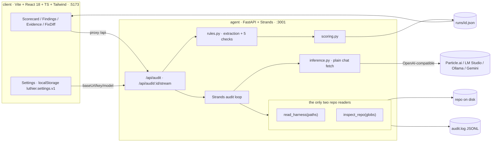
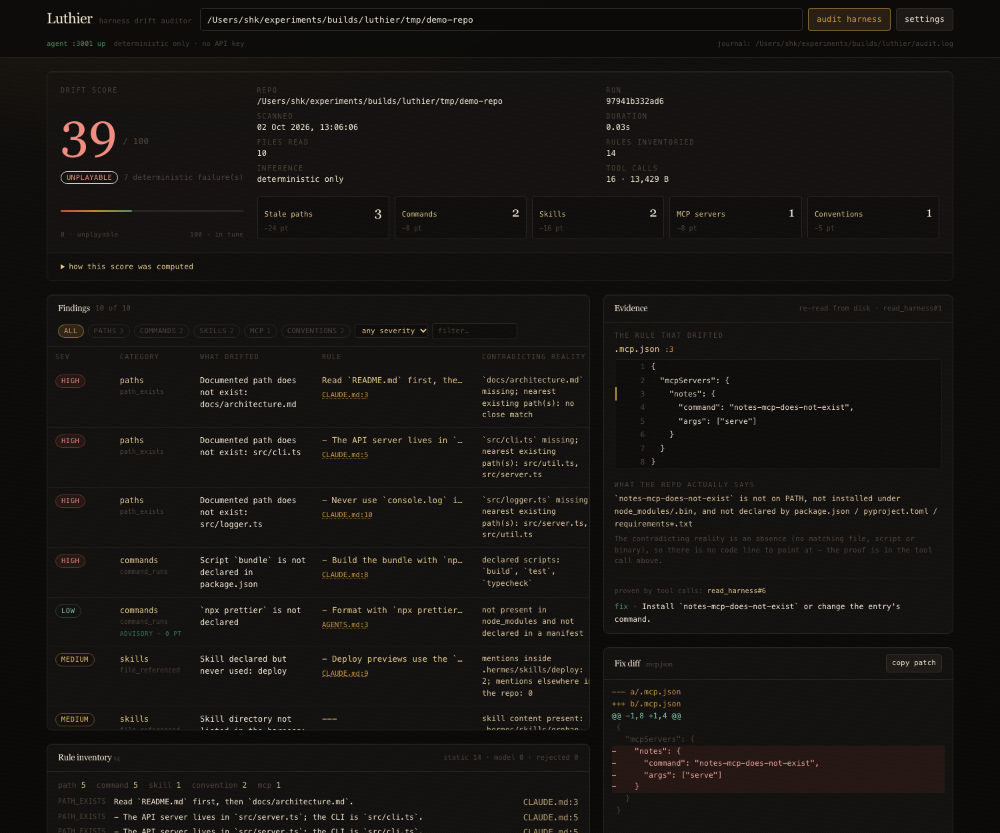
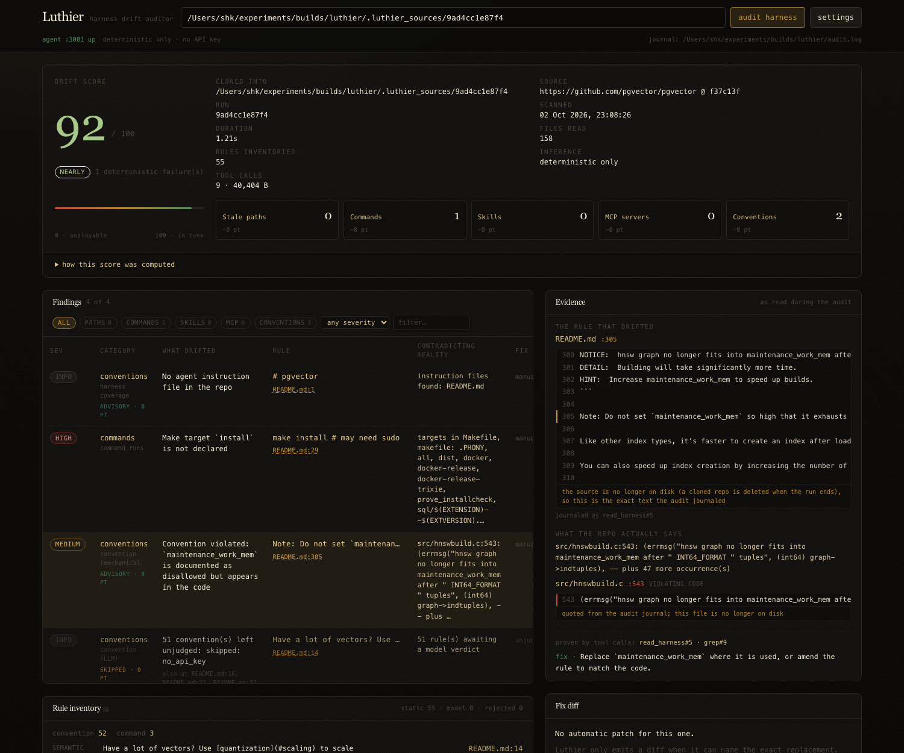

# Luthier

**An agent that audits an AI coding agent's harness against the repo it governs, and reports the
drift with evidence.**

Paste a repo path, a GitHub/GitLab URL, or drop a zip. Luthier enumerates the harness — `CLAUDE.md`,
`AGENTS.md`, `.cursorrules`, `.hermes/skills/**`, MCP config files, README conventions — builds a
**rule inventory**, verifies every rule against what is actually on disk, and returns a **drift
scorecard**: each stale path, unused skill, dead MCP server and violated convention, with the
rule text at `file:line`, the contradicting reality, and a ready-to-apply unified diff.

> In 2026 the harness is where agent cost and failures hide. Every team now checks its code into
> review, CI and the test suite — and nobody checks whether the rules the agent is handed still
> match reality. A `CLAUDE.md` that says `npm run lint:fix` when the script was renamed three
> months ago does not fail loudly. It burns tokens, produces wrong answers, and teaches the agent
> to distrust its own instructions. Luthier is the missing check.

---

## Table of contents

- [What harness drift is](#what-harness-drift-is)
- [The five checks](#the-five-checks)
- [Scoring](#scoring)
- [Architecture](#architecture)
- [Tech stack](#tech-stack)
- [Quick start](#quick-start)
- [HTTP API](#http-api)
- [Evidence guarantees](#evidence-guarantees)
- [Verification](#verification)
- [Repo layout](#repo-layout)
- [Forking and contributing](#forking-and-contributing)
- [Ideas to build on top](#ideas-to-build-on-top)
- [Non-goals](#non-goals)

---

## What harness drift is

A harness is a set of *claims about the repository* written for a model to obey. Claims rot the
moment the code moves. Four failure shapes:

| Shape | Example | What it costs you |
|---|---|---|
| **Stale reference** | `CLAUDE.md:14` says edit `src/old.ts`; the file is now `src/new.ts` | agent hallucinates a file, or edits nothing |
| **Undeclared command** | harness says `npm run checks`; `package.json` declares `check` | agent invents a script, retries, burns turns |
| **Dead capability** | `.mcp.json` configures a server whose binary is not installed | tool-call failure at the worst moment |
| **Orphan / undeclared skill** | `.hermes/skills/deploy/` exists but no harness file lists it | the agent never knows it has the skill |

Luthier treats the harness as a **testable artifact**: extract every claim, assert it against the
repo, report the delta.

---

## The five checks

Rules are typed by the check that can falsify them. Checks 1–4 are **deterministic** — no LLM, no
network, no execution. Check 5 is LLM-judged and degrades to an explicit `skipped: no_api_key`.

| # | check | what it asserts | how it is proven without running anything |
|---|---|---|---|
| 1 | `path_exists` | every path or glob a rule mentions resolves | `inspect_repo` glob match against the real tree; `src/**/*.tsx` matching zero files is drift too |
| 2 | `command_runs` | every documented command is **declared** | unions `package.json` `scripts` (incl. workspaces), `Makefile`/`justfile` targets, `[project.scripts]` entry points, `requirements*.txt` / `pyproject.toml` deps, then `shutil.which` for the binary. Arbitrary commands are **never executed** |
| 3 | `file_referenced` | skills go both ways: declared ⇒ referenced, on-disk ⇒ listed | corpus grep for the skill name/path outside its own directory; disk scan of `.hermes/skills/*`, `.claude/skills/*`, and any directory holding a `SKILL.md` |
| 4 | `server_reachable` | each MCP entry is schema-valid and its command resolves | parses `.mcp.json`, `claude_desktop_config.json`, `.cursor/mcp.json`, `.vscode/mcp.json`, `opencode.json`; validates `command`+`args` vs `url`; resolves the binary on an augmented `PATH`. **Servers are never spawned** |
| 5 | `semantic` | a convention is actually followed by the code | mechanically-checkable conventions (`never use X`, `all <kind> live in <dir>`) are grepped offline; the rest are sent to the model, which must answer `{"verdict":"holds\|violated\|unknown","evidence":"path:line + quote"}` |

`unknown` is a first-class, reportable answer — it costs 1 point and is always shown, never folded
into "clean".

---

## Scoring

Start at 100 and subtract. All weights live in [`agent/scoring.py`](agent/scoring.py) as constants
and are served to the UI by `GET /api/scoring`, so a score is never a black box:

```python
BASE_SCORE                      = 100
FLOOR_SCORE                     = 0
PENALTY_DETERMINISTIC_FAILURE   = 8    # a rule that provably no longer matches the repo
PENALTY_SEMANTIC_VIOLATION      = 5    # a convention judged violated against real code
PENALTY_SEMANTIC_UNKNOWN        = 1    # a convention nobody can confirm either way
MAX_PENALTY_PER_CATEGORY        = 32   # 4 deterministic failures saturate a category
MAX_FINDINGS_PER_CHECK          = 40   # beyond this, extras fold into one "and N more" row
CATEGORIES = ("paths", "commands", "skills", "mcp", "conventions")
```

```
score = max(0, 100 - Σ min(categoryPenalty, 32))
```

Two deliberate refinements:

- **Per-category cap.** One rotten directory of stale paths cannot zero out an otherwise healthy
  harness. A category saturates at 32 (four deterministic failures) and the UI labels it `capped`.
- **Advisory findings cost 0.** Not every true statement is a failure. Three cases are surfaced in
  the table but never scored: an MCP server that is configured yet undocumented; a path a doc says
  the app *writes* at run time (`"stored in run/settings.local.json"`); and a path a prose file
  names inside a directory this repo does not have at all — which is almost always an example
  rather than an instruction. Instruction files (`CLAUDE.md`, `AGENTS.md`, `.cursorrules`,
  `.cursor/rules/*.mdc`) are what an agent loads, so claims there are always charged.

That last rule exists because Luthier audited its own README and scored 42 while flagging
`src/old.ts` — a path this file quotes as an example of drift. Precision matters more than recall
for a score people will act on: 76 after the fix, with the three findings that are genuinely real
still listed.

Severity (`critical → info`) is presentational and drives the chips in the UI; the score is driven
only by check type, category and whether the finding is advisory.

---

## Architecture



Plain-text version of the request path:

```
paste repo path, repo URL, or drop a zip
  └─ POST /api/audit
       ├─ fetch (URL only) ....... git clone --depth 1 → .luthier_sources/<id>  [only egress]
       ├─ discover harness ....... read_harness / inspect_repo  → audit.log
       ├─ extract rules .......... LLM (validated) + static fallback
       ├─ run checks 1-4 ......... deterministic, journaled reads only
       ├─ run check 5 ............ static subset + LLM verdicts | skipped: no_api_key
       ├─ score .................. scoring.compute_score()
       └─ emit SSE progress per stage  →  runs/<id>.json  →  clone deleted
  └─ client renders scorecard; evidence panel re-reads the cited file (5 lines context);
     diff is copy-only — Luthier never writes to the audited repo
```

### The audit loop (Strands Agents)

The loop is a real tool-using agent, and the tools are the only way it learns anything about the
repo. `agent/tools.py`:

```python
def build_strands_tools(bundle: ToolBundle) -> list[Any]:
    """Expose the bundle's two readers as Strands `@tool`s bound to one repo."""
    from strands import tool

    @tool
    def read_harness(paths: list[str]) -> dict:
        """Read harness/instruction files (CLAUDE.md, AGENTS.md, .cursorrules, skills,
        MCP config, README) and return their real contents with 1-based line numbers.
        ...
        Args:
            paths: Repo-relative paths of harness files or directories to read
        """
        return bundle.call("read_harness", {"paths": list(paths)})

    @tool
    def inspect_repo(globs: list[str]) -> dict:
        """Ground truth about the repository: which files match each glob, their sizes,
        and the first 20 lines of each match. Call this before claiming anything about
        what the repo contains. Output is byte-capped and says so when truncated.
        ...
        """
        return bundle.call("inspect_repo", {"globs": list(globs)})

    return [read_harness, inspect_repo]
```

Contents come back as `lineno|text` rows so the model quotes line numbers it did not have to count,
and every call is logged before it is returned:

```json
{"ts": "2026-10-01T18:23:03Z", "runId": "r1", "seq": 2, "tool": "inspect_repo",
 "args": {"globs": ["src/**/*.ts", "Makefile", "*.md"]},
 "durationMs": 0.618, "bytesReturned": 635, "error": null}
```

### Rule extraction, and why the LLM cannot invent a rule

The extraction prompt is strict-JSON and verbatim-bound:

```text
Extract every rule, instruction and claim from the harness files below. Reply ONLY:
{"rules":[{"id":"r1","source":"CLAUDE.md","line":14,
 "kind":"path|command|skill|mcp|convention","text":"<verbatim rule>",
 "check":{"type":"path_exists|command_runs|file_referenced|server_reachable|semantic",
          "target":"src/foo.ts"}}]}
Rules must be verbatim quotes with a real line number. If a rule cannot be checked
mechanically, use kind "convention" and check.type "semantic". Never invent a rule.
```

Every returned rule is then **re-validated against the file that was read from disk**: the line must
be in range and the quoted text must appear at that line (otherwise the rule is rejected and counted
in `rejectedFabricated`). A finding can therefore never cite a line that does not say what it claims.
When no API key is configured, a static extractor (fenced bash blocks, backticked paths, bullet
modals like *must / never / always use*) produces the same rule shape, so checks 1–4 run fully
offline.

---

## Tech stack

| layer | choice | notes |
|---|---|---|
| agent framework | **Strands Agents 1.57.1** (`strands-agents`, `strands-agents-tools`) | `Agent` + `@tool`; `OpenAIModel(client_args={base_url, api_key}, model_id=…)` points the loop at any OpenAI-compatible endpoint |
| server | **Python 3.12 + FastAPI 0.142.2 + uvicorn 0.54** | SSE for live per-check progress; runs kept in memory and on disk |
| inference | **httpx 0.28** (no SDK) | one `POST {base}/chat/completions` with `response_format: {"type":"json_object"}`, retry-without-the-flag on 4xx, `openai 3.22.1` only for the Strands provider |
| client | **Vite + React 18 + TypeScript + Tailwind**, dark theme | `/api` proxied to `:3001`; state in `localStorage` key `luthier.settings.v1` |
| diffs | `difflib.unified_diff` | `--- a/…` / `+++ b/…` headers so `git apply --check` accepts them |
| verification | `python -m agent.verify` | synthetic git fixtures + real-repo runs, PASS/FAIL, non-zero exit on failure |

Models are whatever your endpoint serves; the default preset is Particle.ai `deepseek-v4.1-flash`,
with LM Studio, Ollama (`llama3.2`) and Gemini (`gemini-2.5-flash`) presets.

---

## Quick start

```bash
git clone <your-fork> luthier && cd luthier

# 1. python side (venv + strands + fastapi) and node side
cp .env.example .env            # set REPO_ROOT, and OPENAI_API_KEY if you want check 5
npm run setup                   # .venv + requirements.txt + client deps

# 2. run both servers: agent :3001, client :5173
npm run dev

# 3. prove it works
npm run verify                  # → python -m agent.verify
```

Already have the venv? `uv` works too:

```bash
uv venv --python 3.12 .venv && uv pip install -r requirements.txt
```

Ports: the agent binds `:3001` and the client prefers `:5173`. If another project already holds
`:5173`, Vite falls forward (`5174`, …) rather than failing — the `/api` proxy still points at
`:3001`, so nothing else changes. Override with `PORT=… npm run dev`.

Without an API key the app still audits: deterministic checks run, and the conventions panel says
`skipped: no_api_key` instead of pretending to be clean.

Audit from the shell — a local path, a repo URL, or an archive:

```bash
curl -s localhost:3001/api/audit -X POST -H 'content-type: application/json' \
  -d '{"repoPath":"/absolute/path/to/repo","categories":["paths","commands","mcp"]}'

# a GitHub/GitLab URL is shallow-cloned, audited, then deleted
curl -s localhost:3001/api/audit -X POST -H 'content-type: application/json' \
  -d '{"repoPath":"https://github.com/pgvector/pgvector"}'

curl -s localhost:3001/api/audit -X POST -F file=@~/Downloads/repo-main.zip
```

All three take the same field: `repoPath` is sniffed, so `https://…` or `git@host:owner/repo.git`
means "clone this" and anything else means "read this directory". `/tree/<ref>` URLs are honoured
(cloning that branch), embedded credentials are refused, and the clone is capped at 400 MB / 180 s
via `MAX_CLONE_MB` and `CLONE_TIMEOUT_SECONDS`.

---

## HTTP API

| method | route | purpose |
|---|---|---|
| `GET` | `/api/health` | liveness + resolved `REPO_ROOT` |
| `POST` | `/api/audit` | start a run from `repoPath` (a local path **or** a repo URL) **or** a multipart zip upload → `{ id }` |
| `GET` | `/api/audit/:id/stream` | SSE: `fetch → discover → extract → check:* → score → agent-loop → done` |
| `GET` | `/api/audit/:id` | full result: findings, score ledger, rule inventory, skipped list |
| `GET` | `/api/runs` | recent runs |
| `GET` | `/api/evidence?path=&line=&ctx=` | re-reads the cited file from disk for the Evidence panel |
| `POST` | `/api/inference/test` | real `GET /models` then a 1-token completion; returns status + body, never the key |
| `GET` | `/api/presets` · `/api/scoring` | provider presets; scoring constants rendered in the UI |

Provider overrides arrive per request; the key is used server-side only and is echoed back as a
redacted preview (`pa-…c1d4`).

---

## Evidence guarantees

These are the properties that make a scorecard trustworthy rather than a vibes report:

1. **No claim without a read.** Every finding's existence assertion is backed by a `read_harness` /
   `inspect_repo` journal entry; the finding carries `journalRef` (e.g. `inspect_repo#4`) pointing at
   the exact log line.
2. **Nothing is written.** The audited repo is opened read-only. A zip is extracted to
   `.luthier_uploads/` and a cloned repo lands in `.luthier_sources/` — both inside *this* project,
   both deleted when the run ends, and `.git` is removed from a clone so nothing can reach for
   history. Fix diffs are copy-to-clipboard only, and the UI says so on every diff.
3. **Nothing is executed, and the audit makes no network calls.** Commands are validated as
   *declarations*; MCP servers are never spawned. The only egress in the product is the fetch the
   user explicitly asked for (`git clone --depth 1`, capped at 400 MB / 180 s, credentials-in-URL
   rejected) and the inference endpoint if one is configured.
4. **Bounded and honest about it.** `MAX_BYTES_PER_FILE` (default 20 000), a 160 000-byte
   `inspect_repo` budget, `HEAD_LINES = 20`, `MAX_GLOB_MATCHES = 500`; when any cap bites, the
   payload says `truncated: true` with a note.
5. **Sandboxed.** Reads resolve `..` and symlinks before checking containment; a symlink pointing
   outside the repo is refused (`path escapes the audited repo`).
6. **Model output is audited.** LLM rules must match the file verbatim; LLM evidence must name a path
   that exists, or the verdict is downgraded to `unknown` with the reason recorded.

---

## Verification

```bash
npm run verify        # export PATH="$PWD/.venv/bin:$PATH"; python -m agent.verify
```

`agent/verify.py` builds throwaway git repos in `tempfile.mkdtemp()` and asserts:

1. **Seeded drift is caught.** A fixture whose `CLAUDE.md` references `src/old.ts` (absent), names a
   component at a path it has *moved* (`src/components/Button.tsx` → `src/ui/Button.tsx`), declares a
   skill nothing outside the harness references, ships a skill directory the harness never lists,
   configures an `.mcp.json` server whose binary is bogus, documents `npm run checks` with no such
   script, and states one convention the code violates — each must be flagged at the *right*
   `file:line`.
2. **A clean repo is clean.** A second fixture must score **≥ 95** with **zero deterministic
   failures** (guarding against a checker that flags everything). It scores 100 with zero findings.
3. **Diffs apply.** Every generated diff is checked with `git apply --check` against a git-committed
   copy of the fixture, and the rename case must produce a diff naming the real path.
4. **Evidence is real.** Every finding has a non-empty `evidence` whose path exists on disk, every
   `ruleFile:ruleLine` must be a real line in a real file, and no finding may have an empty
   `reality`.
5. **Nothing is invented.** Rule sources must be files that exist in the fixture, the un-keyed LLM
   pass must report `skipped: no_api_key`, unjudged conventions must appear as findings rather than
   vanish, and `audit.log` must be valid JSONL carrying tool/args/duration/bytes.
6. Prints `PASS`/`FAIL` per assertion and exits non-zero on any failure.

```text
Luthier verification
repo root for audit.log: /Users/shk/experiments/builds/luthier

1. seeded drift in the drifted fixture
  PASS  stale path src/old.ts flagged
        expected CLAUDE.md:5
  PASS  stale path cites CLAUDE.md:<line>
        got CLAUDE.md:5
  PASS  declared-but-unused skill flagged
        expected CLAUDE.md:10
  PASS  unused skill cites CLAUDE.md:<line>
        got CLAUDE.md:10
  PASS  on-disk skill missing from the harness flagged
        evidence: {"path": ".hermes/skills/ghost/SKILL.md", "line": 1, "text": "---", "quote": ".hermes/skills/ghost/SKILL.md:1", "context": [{"line": 1, "text": "---"}, {"line":
  PASS  bogus MCP binary flagged
  PASS  dead MCP server cites .mcp.json
        got .mcp.json:3
  PASS  violated convention flagged
        evidence: {"path": "CLAUDE.md", "line": 11, "text": "- Never use `console.log` in committed code.", "quote": "CLAUDE.md:11", "context": [{"line": 6, "text": "- The `Button` component is in `src/components/Butto
  PASS  convention finding quotes the offending code
        reality="src/app.ts:4: console.log('starting', argv.length);" evidence.reality={"path": "src/app.ts", "line": 4, "text": "console.log('starting', argv.length);", "quote": "src/app.ts:4", "ref": "grep#15", "label": "violating code"}
  PASS  convention quote is a real line in the cited file
  PASS  undeclared npm script flagged
  PASS  drifted fixture scores below 90
        drift score = 47
  PASS  drifted fixture has deterministic failures
        deterministicFailures = 6

2. clean fixture
  PASS  clean fixture scores >= 95
        drift score = 100
  PASS  clean fixture has zero deterministic failures
        findings: []

3. fix diffs
  PASS  at least one fix diff is produced
        5 finding(s) carry a diff
  PASS  moved file is flagged with a rename diff to the real path
        --- a/CLAUDE.md
        +++ b/CLAUDE.md
        @@ -3,7 +3,7 @@
         Read `README.md` before anything else.
         
         - Edit `src/old.ts` when the CLI output changes.
        -- The `Button` component is in `src/components/Button.tsx`.
        +- The `Button` component is in `src/ui/Button.tsx`.
  PASS  git apply --check: server_reachable @ .mcp.json
        --- a/.mcp.json
        +++ b/.mcp.json
        @@ -1,9 +1,4 @@
         {
           "mcpServers": {
        -    "notes": {
  PASS  git apply --check: path_exists @ CLAUDE.md
        --- a/CLAUDE.md
        +++ b/CLAUDE.md
        @@ -2,7 +2,6 @@
         
         Read `README.md` before anything else.
         
  PASS  git apply --check: path_exists @ CLAUDE.md
        --- a/CLAUDE.md
        +++ b/CLAUDE.md
        @@ -3,7 +3,7 @@
         Read `README.md` before anything else.
         
         - Edit `src/old.ts` when the CLI output changes.
  PASS  git apply --check: file_referenced @ CLAUDE.md
        --- a/CLAUDE.md
        +++ b/CLAUDE.md
        @@ -7,5 +7,4 @@
         - Shared helpers live in `src/util.ts`.
         - Always run `npm run build` before committing.
         - Use `npm run checks` to validate a change.
  PASS  git apply --check: skill_unlisted @ .hermes/skills/ghost/SKILL.md
        --- a/CLAUDE.md
        +++ b/CLAUDE.md
        @@ -9,3 +9,6 @@
         - Use `npm run checks` to validate a change.
         - Deploy with the `drift-note` skill in `.hermes/skills/drift-note/`.
         - Never use `console.log` in committed code.

4. evidence
  PASS  every cited ruleFile:ruleLine is a real line
        invalid: 
  PASS  every finding has non-empty evidence
        missing evidence: 
  PASS  every finding states the contradicting reality
        empty reality: 

5. no fabrication
  PASS  rules come from real harness files
        sources: ['CLAUDE.md', 'README.md']
  PASS  deterministic-only run reports the LLM pass as skipped
        skipped: [{"stage": "rule-extraction", "reason": "skipped: no_api_key", "detail": "static extraction only; convention rules still get the mechanical subset"}, {"stage": "check-conventions-llm", "reason": "skipped: no_api_key", "r
  PASS  unjudged conventions are surfaced, not hidden
        1 skipped finding(s)
  PASS  every audit used the journaled readers
        tool calls: {"inspect_repo": {"calls": 8, "bytes": 10191, "errors": 0}, "read_harness": {"calls": 3, "bytes": 1712, "errors": 0}, "scan_repo": {"calls": 1, "bytes": 197, "errors": 0}, "grep": {"calls": 3, "bytes": 354, "errors": 0}}
  PASS  audit.log records tool, args, duration and bytes
        log: /Users/shk/experiments/builds/luthier/audit.log

========================================================================
drifted fixture  score  47  findings  9  rules  9  tool calls 15
clean fixture    score 100  findings  0  rules  4

30 passed, 0 failed
PASS
full drifted report: /var/folders/d7/5zhspxcn5bngg7szs6hsx1lh0000gn/T/luthier-verify-z4ejgnzm/drifted-report.json
```

Full run: 30 assertions, 0 failures. The detail lines are printed by the suite itself, so a
failing citation shows the JSON it actually produced.

### The Strands loop, checked without a hosted key

`scripts/agent_loop_check.py` boots a local mock OpenAI-compatible endpoint, points the running
server at it, and asserts the agent's tool call really went through `ToolBundle`:

```text
mock OpenAI-compatible endpoint on 127.0.0.1:3002
run 14c83c713cd4: waiting for the audit to finish

Strands audit-loop check
  PASS  mock endpoint received the agent's request
  PASS  agent loop reported ok
  PASS  agent made at least one journaled tool call
  PASS  narrative text came back
  PASS  deterministic findings still present
  PASS  drift score computed
  PASS  agent tool call written to audit.log
  PASS  API key never echoed to the client

  provider turns: 2, agent tool calls: 1
  score: 31, findings: 10
PASS
```

This proves the integration (Strands `@tool` → `ToolBundle` → `audit.log` → narrative). It says
nothing about any provider's judgement quality — the mock is ours, and no hosted key was available
in the environment this was built in.

### Real repos

| repo | source | files | rules | hard findings | advisory | score |
|---|---|---|---|---|---|---|
| `pgvector/pgvector` | cloned by URL | 158 | 55 | 1 | 2 | **92** |
| `checkpoint` (real project, README-only harness) | local path | 108 | 80 | 0 | 2 | **100** |
| `tmp/demo-repo` (seeded fixture) | local path | 10 | 14 | 7 | 2 | **39** |
| `luthier` (this repo, self-audit) | local path | 40+ | 82 | 3 | 11 | **76** |

The single hard finding on `pgvector` is `make install` — a target PGXS provides via
`include $(PGXS)` rather than the repo's own `Makefile`. That is the known limitation documented
below, not a phantom: the audit is only as deep as the declarations it can read on disk. The
`maintenance_work_mem` convention hit is advisory (0 points) precisely because a README line about
tuning a Postgres setting is guidance, not a rule the C source is breaking.

Scorecard from a run against a real repo:



The same view for a repo cloned from a URL, where the clone has already been deleted and the
evidence panel falls back to the text the audit journaled:



*Captured from the running client; both are shareable as
`http://127.0.0.1:5173/?run=<id>&finding=<id>` because every run is persisted under `runs/`.*

---

## Repo layout

```
luthier/
├── agent/
│   ├── main.py        FastAPI app: /api/audit, /api/audit/:id/stream, Strands audit loop
│   ├── tools.py       read_harness, inspect_repo, ToolBundle, audit.log + journal
│   ├── sources.py     the network boundary: URL parsing + `git clone --depth 1` into a temp dir
│   ├── rules.py       harness discovery, rule extraction, the five checks, diff builders
│   ├── scoring.py     drift scoring constants + compute_score()
│   ├── inference.py   plain chat fetch to an OpenAI-compatible endpoint + presets
│   └── verify.py      python -m agent.verify
├── client/
│   └── src/components/  Scorecard.tsx Findings.tsx Evidence.tsx FixDiff.tsx Settings.tsx
├── runs/              one JSON file per audit run (gitignored)
├── audit.log          JSONL tool-call log for the latest run (gitignored)
├── docs/
│   ├── assets/scorecard.png   the README screenshot, captured from the running client
│   ├── blog-harness-drift.md  the long-form write-up of the design and its traps
│   └── launch-notes.md        X thread + LinkedIn copy
├── scripts/
│   ├── dev.sh                 boots :3001 and the client together
│   └── agent_loop_check.py    Strands loop proven against a local mock endpoint
└── .env.example       copy to .env (never committed)
```

Deep links: every run is persisted, so `http://127.0.0.1:5173/?run=<id>&finding=<id>` reopens a
finished scorecard with one finding's evidence panel selected — which is how the screenshot above
was captured.

---

## Forking and contributing

```bash
git clone https://github.com/<you>/luthier.git
git checkout -b feat/<your-check>
npm run setup && npm run dev        # client :5173, agent :3001
npm run verify                      # must stay green
```

Conventions this repo keeps:

- **Checks are pure functions of journaled reads.** If a new check needs repo data, it asks
  `ToolBundle` — never `open()` directly — so `audit.log` stays a complete explanation of a score.
- **Every finding needs `file:line`, `reality`, `evidence`, `suggestion`,** and a `diff` *only* when
  a confident fix exists. `diff: null` with a written suggestion beats a guessed patch.
- **No new penalty class without a constant.** Change `scoring.py`, let `GET /api/scoring` render it,
  and update the table above.
- **Offline-first.** Anything that cannot run without a key must report `skipped: <reason>`, not fail
  silently.
- Type hints throughout, `from __future__ import annotations`, stdlib-first; Python 3.11+ (3.12 in CI),
  and no formatter churn — match the file you are editing.

Adding a check in four steps:

```python
# 1. agent/rules.py -- inside RuleExtractor._extract_line, emit the rule with a real line number
if ENV_TOKEN_RE.search(stripped):
    self._add(hf, line, "convention", "env_declared", stripped[:400])

# 2. agent/rules.py -- a check on ChecksMixin. `self.add` folds exact repeats and stamps the
#    journal ref; every repo fact it asserts comes out of the bundle, never a bare open().
async def check_env(self, emit: ProgressFn = None) -> None:
    if not self.wanted("conventions"):
        self.note_skipped("check-env", "skipped: category disabled")
        return
    declared = set(_dotenv_keys(self.bundle.read_text(".env.example") or ""))
    used = {hit.regex_match.group(1) for hit in self.bundle.grep(r"process\.env\.(\w+)")
            if hit.regex_match}                      # grep is journaled too
    for rule in [r for r in self.rules if r.check == "env_declared"]:
        missing = sorted(used - declared)
        if not missing:
            continue
        self.add(category="conventions", check="env_declared", severity="low",
                 title=f"Undeclared env var(s): {', '.join(missing[:3])}",
                 message=f"{rule.source}:{rule.line} relies on env .env.example omits",
                 ruleText=rule.text, ruleFile=rule.source, ruleLine=rule.line,
                 reality=f"used but not declared: {', '.join(missing)}",
                 evidence=self.rule_evidence(rule),
                 suggestion="Add the keys to .env.example.",
                 diff=None, deterministic=True, engine="static")

# 3. agent/scoring.py -- one category, one constant, one line in the table above
# 4. agent/verify.py -- a fixture that seeds the drift, and an assertion on its file:line
```

Open an issue first for anything that changes the scorecard's meaning; a PR that adds a check should
ship the fixture that seeds it.

### Ideas to build on top

Ranked by how much value they add per unit of effort:

1. **Baseline / watch mode.** Store a run as a baseline and diff drift between runs — `harness drift
   went 92 → 71 this week` is the report that actually gets read.
2. **CI gate.** `luthier --fail-under 85 --only paths,commands` in a workflow, plus a PR comment with
   the scorecard. Non-zero exit already exists in `verify.py`.
3. **Cross-harness contradiction detection.** `CLAUDE.md` says pnpm, `.cursorrules` says npm, README
   says yarn — three sources of truth is itself the finding.
4. **Cost attribution.** Estimate tokens/turns each stale rule plausibly costs (retry loops on
   missing files, failed MCP spawns) and sort findings by it.
5. **Fix-application mode.** Opt-in `--apply` behind a dry-run preview and git checkpoint, reusing
   the diffs that already pass `git apply --check`.
6. **Model-aware rewriting.** Feed the confirmed-drift list back to the model to regenerate the
   `CLAUDE.md` section rather than patching lines.
7. **More harness dialects.** `QODER.md`, `.github/copilot-instructions.md`, `opencode.json`,
   `.windsurfrules`, `GEMINI.md`, GCS `SKILL.md` frontmatter, sub-agent `.claude/agents/*.md`.
8. **Skill graph.** Skills that reference each other, or that only a dead skill references.
9. **House-style lint.** Rules about error handling, logging and file size are checkable with a
   tree-sitter pass — same finding shape, new engine.
10. **Explain-a-score.** Click the number, read the ledger in prose: which 6 findings cost 41 points
    and which single edit recovers the most.

## Non-goals

No writes to the audited repo. No network access **from the checks** — a repo URL is fetched once,
up front, by user request, and the auditor then works on an ordinary local directory. No auth, no
CI integration, no multi-repo dashboards, no git-history analysis (which is why `.git` is stripped
from clones). This is a local instrument, not a service.

## Known limits

Worth stating plainly, because a score you cannot interrogate is not worth acting on:

- **Make targets inherited from an included makefile read as undeclared.** `make install` in a PGXS
  extension (`pgvector`) is provided by `$(PGXS)`, not the repo's own `Makefile`, so
  `command_runs` reports it as not declared. Only targets literally present in the repo's
  makefiles/justfiles are known.
- **A rename is only patched when it is provably a rename** — same file name in a different
  directory, or ≥0.86 path similarity. Looser guesses go in the suggestion text, never in a diff.
- **Docs-role files (`README.md`, `docs/**`) contribute advisory findings** for path and skill
  claims, since prose is full of illustrative paths. Instruction files are always charged.
- **Glob patterns in a harness are checked for ≥1 match**, not for the author's intent.
- **The LLM pass judges only what the digest contains.** It is given the file list and manifests,
  not the source of every file, so a `holds` verdict is bounded by that digest — which is why
  `unknown` exists and is scored rather than hidden.